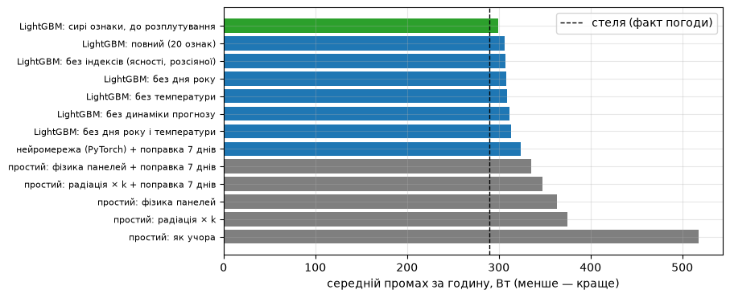

# deye-solar-forecast

Hour-by-hour forecast of how much energy my home solar panels will produce today, trained on two years of my own Deye station history and running on a Raspberry Pi.

The real question behind it: during a blackout, how long will the battery last? An honest answer needs the sun for every remaining hour of the day, not the current generation.

**Final model:** LightGBM + a dynamic correction, **296 W** mean absolute error per hour (24 % of mean generation, ~85 % daily accuracy). A no-ML physics baseline gets 335 W. The same model fed *actual* weather instead of a forecast gets 290 W, so the rest of the error is the weather forecast.



## What I found

- **The battery was hiding the sun.** In zero-export mode the inverter throttles the panels once the battery is nearly full. It starts at **93 %**, not 97 % as I assumed. Hundreds of throttled afternoon hours were in the training data, so the model learned that "panels are weak after lunch". Fixing one filter threshold gained more than all features and corrections together.
- **Every ML win was 3-6 W.** LightGBM beats the physics baseline, and snow features and panel orientation each help a little. Stacking, daily mini-models, a neural network and a learned correction model did not beat a one-line formula.
- **A correction model looked best thanks to a leak.** Trained on in-sample residuals, it won 100 % of bootstrap samples. Trained honestly (out-of-fold), it lost.
- **The model does not age.** A model trained once on 2025 plus a dynamic correction matches monthly retraining (302 vs 302 W). Panels do not degrade; snow and dust come and go.

| Step | Error, W/hour |
|---|---|
| "Same as yesterday" | 518 |
| Panel physics (pvlib), no correction | 363 |
| Panel physics + 7-day correction (baseline) | 335 |
| Neural network + correction | 324 |
| LightGBM v1, 20 features + 7-day correction | 306 |
| LightGBM v1 + dynamic correction | 302 |
| + panel orientation factor | 299 |
| **LightGBM v2: + snow and frost features** | **296** |
| Ceiling: v1 on actual weather (ERA5) | 290 |

Test period: 23 Dec 2025 - 24 Oct 2026, walk-forward with monthly retraining, clean hours only, day-block bootstrap for every "A beats B".

## Read more

- [docs/RESEARCH.uk.md](docs/RESEARCH.uk.md): the full write-up with 18 hypotheses and verdicts, figures and lessons for ML on time-series tabular data (Ukrainian; English version coming).
- [docs/THINKING.uk.md](docs/THINKING.uk.md): the short version. 11 ideas in the order I had them: hypothesis, check, result, what it led to.

## How it works

```
Deye Cloud (5-min history) ─┐
                            ├─ dataset.py ─ notebooks 01-07 ─ train.py ─ models/
Open-Meteo (ERA5, forecast, ┘                                              │
  previous runs day1/day2)                                                 ▼
                                           Raspberry Pi: live.py, hourly → SQLite
```

- **Target:** PV generation from the Deye Cloud, resampled to hours. Hours where the battery was ≥ 93 % with no grid import are marked as clipped and excluded.
- **Features:** fresh Open-Meteo forecast (radiation, clouds, temperature, wind, snow), clear-sky index and diffuse fraction, sun position, how the forecast changed between runs, snow on panels, and a pvlib orientation factor for my panel plane (10° tilt, 220° azimuth, found from clear days).
- **Live:** four models run side by side on the Pi every hour and log forecast and actuals: physics, LightGBM v1, LightGBM v2 (all with the dynamic correction), plus physics + a learned correction. Nothing is sent anywhere. The journal decides which one wins on real days.

## Run it on your own station

You need a Deye inverter connected to Deye Cloud and a [developer account](https://developer.deyecloud.com).

```bash
python -m venv .venv && source .venv/bin/activate
pip install -r requirements.txt
cp .env.example .env            # fill in Deye Cloud credentials and station id

python fetch_deye.py            # history → data/deye/, station info → data/station.json
python fetch_weather.py         # Open-Meteo for the station location → data/weather/

python -m ipykernel install --user --name solar-forecast
cd notebooks
python make_02_dataset.py && jupyter nbconvert --to notebook --execute --inplace 02_dataset.ipynb
# …the same for 03-07; each make_*.py builds its notebook

cd .. && python train.py        # trains the four live models → models/
docker build -t solar-forecast . && docker run -v ./live:/app/live --env-file .env solar-forecast
python report.py                # compare the models on live days
```

Your panels, roof and battery are different, so expect different numbers. The clipping rule (`FULL_SOC = 93` in `dataset.py`) is worth checking first on any zero-export hybrid inverter.

The station history, weather data and trained models are not included: they belong to a real home.

## Stack

Python, pandas, LightGBM, pvlib, PyTorch (for the comparison), Jupyter, Open-Meteo (ERA5 archive, historical forecasts, Previous Runs API), Deye Cloud developer API, Docker on a Raspberry Pi. Written together with Claude Code; every number in the docs comes from executed notebooks.

## License

MIT
