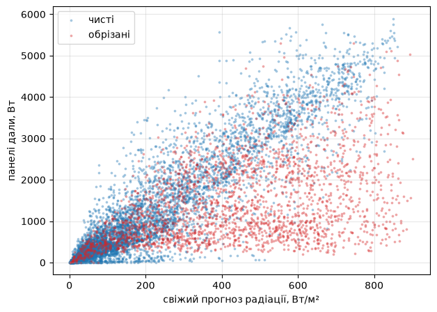
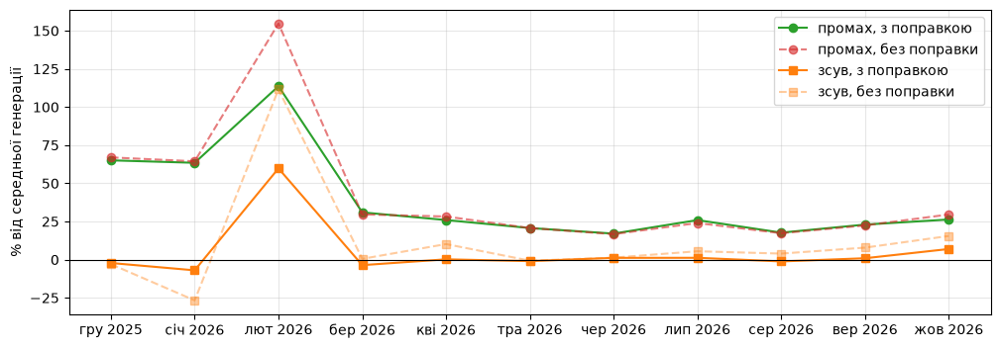
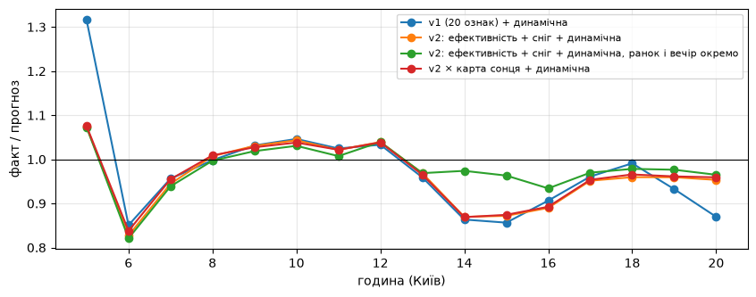
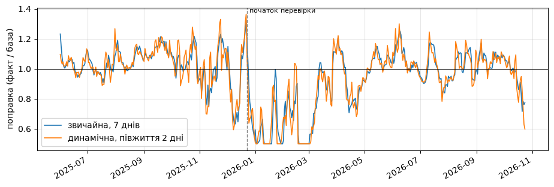
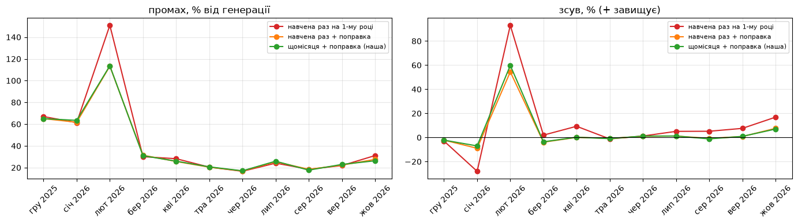
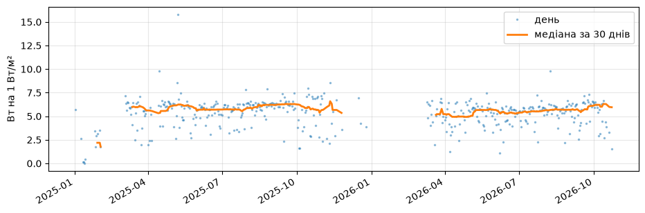
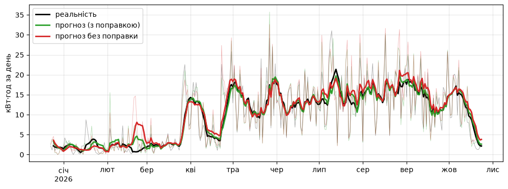
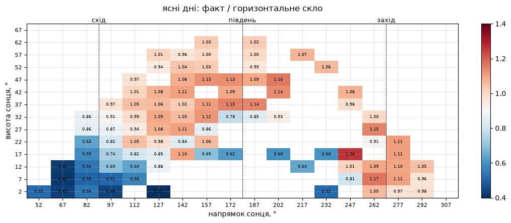
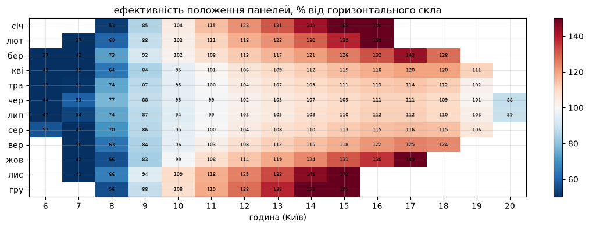

# Прогноз сонця: що навчила модель

2026-10-25 · Martyn

## Звідки взялась задача

У мене вдома гібридний інвертор Deye, 6 кВт сонячних панелей і батарея приблизно на 10 кВт·год. Під час відключень головне питання одне: на скільки вистачить батареї. Raspberry Pi читає інвертор кожні 5 секунд, рахує запас ходу і показує його на екрані та в Telegram.

Перша версія цього прогнозу брехала. При 703 Вт навантаження бот обіцяв 13 годин, о 6:56 при 572 Вт уже 9, о 11:02 при 559 Вт лише 8. Причин виявилось дві. Чайник на дві хвилини подвоював середнє навантаження за 5 хвилин, і запас падав удвічі. А сонце формула вважала вічним: удень, коли панелі покривали дім, виходило «вистачить на 173 години». Медіану за 15 хвилин я поставив одразу, а сонце з формули довелось прибрати зовсім. Поточна генерація нічого не каже про вечір.

Чесно рахувати запас можна лише погодинно: заряд мінус (споживання мінус сонце) для кожної наступної години. Для цього потрібен прогноз, скільки сонця дадуть саме мої панелі в кожну годину до вечора. Так з'явилась задача: модель генерації, навчена на моїй власній історії.

Що я мав на старті: два роки історії станції в хмарі Deye з кроком 5 хвилин, безкоштовний архів погоди Open-Meteo і Mac. Готові рішення на кшталт open-meteo-solar-forecast, Quartz Solar Forecast чи EMHASS я подивився, але жодне не знає про головну особливість моїх даних, про яку далі. Усе дослідження вклалось у 12 ноутбуків, приблизно 6 тисяч чистих годин для навчання і модель LightGBM, яка вчиться за секунди. Відеокарта і хмарні обчислення не знадобились.

## Дані і перші пастки

Ціль моделі (y) — генерація панелей з хмари Deye: 738 днів, 193 тисячі записів по 5 хвилин, 128 МБ. Ознаки (X) — погода Open-Meteo для координат станції, чотири набори по 17 712 годин кожен.

| Набір | Що це | Похибка радіації вдень проти ERA5 |
|---|---|---|
| archive | ERA5, факт погоди за сіткою ~25 км. Стеля точності | — |
| forecast | свіжий прогноз на найближчі години | 52 Вт/м² |
| day1 | прогноз за добу наперед | 54 Вт/м² |
| day2 | прогноз за дві доби | 62 Вт/м² |

Навчати треба на прогнозі, а не на факті погоди. У роботі модель бачитиме прогноз, тож має навчитись і на його помилках. Факт ERA5 потрібен лише як стеля: скільки точності можна було б мати з ідеальною погодою.

Ще до першої моделі дані підкинули п'ять пасток. Кожна з них непомітно зламала б модель.

1. **Zero export.** Інвертор працює в режимі «не віддавати в мережу». Коли батарея повна, він обрізає сонце до рівня споживання дому. У такі години в історії записано не те, скільки панелі могли дати, а скільки в них забрали. Спочатку я вважав обрізаними години з зарядом від 97 %. Таких виявилось 22 % денних годин, улітку до 35 %. Ця межа пізніше виявилась головною помилкою всього дослідження, про це в окремому розділі.
2. **Зсув часу на годину.** Open-Meteo підписує годину її кінцем, Deye — початком. Без зсуву кореляція сонця з радіацією була 0,57, зі зсувом 0,65. Модель вчилась би на погоді сусідньої години.
3. **Панелі запрацювали не з першого дня.** Станцію підключили 17 жовтня 2024, а сонце в даних з'явилось лише 23 грудня: панелі ще добудовували. Два місяці нулів без фільтра навчили б модель, що восени сонця не буває.
4. **Порожнє значення не дорівнює нулю, а нуль не дорівнює порожньому.** Поле «мережа» в хмарі порожнє, коли купівлі немає, і це нуль. А от дірки в генерації нулями заповнювати не можна: модель вивчила б вигадку.
5. **Дірки.** Найдовша — 66 годин наприкінці січня 2026: ожеледиця, впали сім стовпів разом з інтернетом. Дірки до 30 хвилин я заповнив лінійно, довші викинув. Це менше 1 % годин, і латати їх моделлю для навчання не варто: модель вчилась би на власних припущеннях.

При тій самій радіації обрізані години лежать нижче: батарея повна, інвертор узяв сонця рівно на дім. Без фільтра модель вирішила б, що панелі слабші, ніж є.

У підсумку з 8 361 денної години для навчання лишилось спочатку 6 229, а після виправлення межі обрізання 5 907. Правила відбору записані в коді й прості. Година обрізана, якщо щонайменше пів години батарея мала 93 % і більше, а з мережі бралось менше 30 Вт: таких 2 385. Година ненадійна, якщо в ній менше 6 записів із 12: таких 69. Ще 3 години я викинув як збій датчика: за ERA5 ясно, снігу нема, радіація понад 400 Вт/м², а панелі дали менше чверті звичайного. Споживання дому я вирішив не моделювати взагалі: чайник і душ непередбачувані, і людина сама керує ними, дивлячись на прогноз сонця. Для запасу батареї вистачить медіани споживання за останні тижні по годинах доби.

## Як я перевіряв, щоб не обдурити себе

Усі числа в статті пораховані однаково, інакше їх не можна порівнювати. Правила такі.

- **Поділ за часом, не випадковий.** Навчання на першому році (23 грудня 2024 – 22 грудня 2025, 3 434 чистих години), перевірка на решті до 24 жовтня 2026 (2 473 години). Сусідні години майже однакові, тож випадковий поділ показав би казкову точність.
- **Walk-forward по місяцях.** На початку кожного місяця перевірки модель перенавчається на всьому, що було до нього. Так вона працюватиме й у житті.
- **Одна міра для всіх.** MAE, середній промах за годину в ватах, лише на чистих годинах перевірки (середня генерація в перевірці 1 209 Вт). Поруч зсув: чи метод систематично завищує.
- **Bootstrap по днях, не по годинах.** Щоб сказати «А краще за Б», я 2 000 разів брав випадковий набір днів і рахував, як часто А виграє. Дні, бо години всередині дня залежні. Менше 95 % перемог я вважав шумом. Без цього різниця 302 проти 306 Вт виглядає як перемога, а насправді може бути випадковістю.
- **Планка без ML.** Перш ніж вчити модель, я порахував три прості методи: «як учора в цю годину», «радіація × коефіцієнт» і «фізика панелей» (радіація перерахована на нахилену площину через pvlib). Це те, що роблять готові бібліотеки. Модель має сенс, лише якщо б'є найкращий з них.
- **Стеля.** Та сама модель, але на фактичній погоді ERA5 замість прогнозу. Вона показує, скільки промаху дає неточний прогноз погоди, а скільки ще можна виграти моделлю.

Планка вийшла високою. «Фізика панелей» з поправкою на останні 7 днів дає 335 Вт промаху за годину, «як учора» — 518. Стеля — 290 Вт. Тобто весь простір для ML з самого початку був затиснутий між 335 і 290. Це корисно знати до того, як почати підбирати гіперпараметри.

Щоб результати можна було повторити, ось налаштування, які не мінялись протягом усього дослідження. LightGBM: 600 дерев, крок навчання 0,03, 31 лист, щонайменше 20 рядків у листі, підвибірка рядків і ознак 0,8, L2-регуляризація 1,0. Поправка: сума факту за 7 останніх завершених днів, поділена на суму прогнозу за ті самі дні, обрізана до меж 0,5–1,5. Динамічна поправка: те саме на 14 днях, вага дня 0,5 у степені (вік у днях / 2). Ознак у v1 двадцять: сім полів свіжого прогнозу (радіація, температура, вологість, вітер, хмарність, опади, снігопад), індекс ясності і частка розсіяної, висота й напрямок сонця, день року як синус і косинус, снігопад за 3 доби і шість різниць між версіями прогнозу для радіації та хмарності. v2 додає ефективність положення панелей з pvlib і п'ять ознак снігу та інею: розрахунковий сніг на панелях, днів після снігопаду, прогноз глибини снігу, мінімум температури і максимум вологості за ніч.

## Гіпотези і вердикти

З 18 гіпотез підтвердились 7, і жодна з них не була «складніша модель». Все, що додавало шарів поверх LightGBM, програло простій формулі. Все, що давало моделі фізичну причину або чистило дані, виграло. Числа — середній промах за годину в ватах на очищених даних, якщо не сказано інше. «% вибірок» — як часто варіант виграв у bootstrap по днях.

| № | Гіпотеза | Що показали дані | Вердикт |
|---|---|---|---|
| 1 | ML точніше за фізику панелей | LightGBM 306 проти 335, 100 % вибірок. До очищення даних було 353 проти 372, на межі шуму | Так, але виграш скромний |
| 2 | Розкид між версіями прогнозу (day2, day1, свіжий) показує, наскільки йому вірити | Коли версії збігаються, промах погоди 5 Вт/м², коли розходяться — 78. Після нормування на ясне небо різниця 4 рази, а не 15. Без цих ознак 312 проти 306 | Так, слабше ніж здавалось |
| 3 | День року потрібен понад висоту сонця | Без нього 308 проти 306, 25 % вибірок. Шум | Ні |
| 4 | Температура повітря допомагає | Без неї 309, 10 % вибірок. До очищення здавалась марною | Так, видно лише на чистих даних |
| 5 | Розплутування корельованих ознак (індекс ясності, частка розсіяної, свіжий + зміни) підвищить точність | Сирі 33 ознаки 299 проти 306 у розплутаних 20, 98 % вибірок | Ні для дерев. Корисно для розуміння |
| 6 | Поправка на останні 7 днів (факт / прогноз) | Фізика 363 → 335, LightGBM 310 → 306. Січень 408 → 271 | Так, найбільший окремий виграш для фізики |
| 7 | Динамічна поправка: вчора важить більше (півжиття 2 дні) | LightGBM 306 → 302 (98 % вибірок), фізика 335 → 332 (96 %). Увесь виграш узимку: +12 Вт у грудні, +25 у січні. 14 днів не краще за 7 (54 %) | Так, невеликий |
| 8 | Поправка окремо для ранку і вечора, сонячних і хмарних годин | 334–337 проти 335. У v2 ранок/вечір 298 проти 296. За тиждень у групі замало годин | Ні |
| 9 | Модель поправки замість формули | На базі LightGBM гірша в усіх варіантах: 315–333 проти 302. Нечесна версія на фізиці виглядала найкращою (303) | Ні. Приховувала витік |
| 10 | Щодня нова маленька модель на ковзних 7 днях (306 моделей) | 303–304 проти 302. Кожна бачить 50–75 годин | Ні, на рівні формули |
| 11 | Стекінг і модель поправки на 2 роках чесних (out-of-fold) прогнозів | На фізиці 293, майже LightGBM. На LightGBM 321–339, зсув +72–86 Вт | Ні як поправка. Це переодягнена основна модель |
| 12 | Панелі зношуються: 2026 слабший на 10–30 % | Той самий місяць 2026 до 2025: березень 104 %, травень 104 %, жовтень 110 %, квітень 86 %. Зношення йшло б лише вниз | Ні. Сніг, бруд і батарея |
| 13 | Провал о 13–16 на ясних днях — тінь або орієнтація | Факт / модель 1,0 при заряді до 93 %, 0,81–0,86 при 93–97 %. Інвертор притискає сонце вже з 93 %, а не з 97 | Ні. Головна помилка даних |
| 14 | Сніг та іній як ознаки | 302 → 296, узимку 253 → 235, 98 % вибірок. Найкраща окрема — «днів після снігопаду» | Так |
| 15 | Ефективність положення панелей як ознака (формула з дати і часу) | 302 → 299. Карта сонця поверх v2: 296 → 295 | Так, невеликий |
| 16 | Нейромережа (PyTorch, 64-32) замість дерев | 324 проти 306, на рівні фізики | Ні |
| 17 | Перенавчання щомісяця важливе | Навчена раз на 2025-му: 311 Вт. Вона ж з поправкою 302, щомісячна з поправкою теж 302. Перенавчання дає 0, поправка 9 | Ні, модель не старіє |
| 18 | Ознака «днів від запуску» навчить тренду | 311 проти 302, 1 % вибірок | Ні, шкодить |

Сірі стовпчики — методи без ML, сині — варіанти LightGBM з прибраними групами ознак, зелений — найточніший. Відстань від будь-якого синього до пунктиру менша за відстань між сірими.

Зверніть увагу на масштаб. Усі перемоги на моделі — це 3–6 Вт кожна. Одна виправлена межа в даних (гіпотеза 13) дала більше, ніж усі вони разом.

## Що вирішувало проблему, а що її маскувало

Найбільший виграш дала не модель, а знайдена помилка в розмітці даних. І найдовше цю помилку ховав саме той прийом, який найбільше покращував метрику.

### Поправка лікувала симптом і ховала причину

На перших прогонах усі методи без поправки завищували на 100–135 Вт. Поправка на 7 днів зводила зсув майже до нуля, і всі були задоволені. Я пояснив це зношенням: на другий рік панелі давали на 10–30 % менше на ту саму радіацію. Звучало переконливо, дані не заперечували.

Для порівняння, так поправка виглядає у фінальній моделі по місяцях перевірки:

Поправка працює в січні та лютому: зсув у січні з −27 % до −7 %, промах у лютому зі 154 % до 113 %. З квітня по жовтень вона майже нічого не змінює.

Розбір помилок показав дивний провал: о 13–16 на ясних днях модель завищувала на 12 %. Перша думка — тінь або неправильна орієнтація. Але панелі дивляться на південний захід, і після обіду вони мають давати більше, а не менше. Тоді я розбив ті самі години за зарядом батареї.

| Заряд батареї | 9–11 год: факт / модель | 13–16 год: факт / модель |
|---|---|---|
| до 93 % | 1,00–1,03 | 0,95–1,00 |
| 93–97 % | 0,86 | 0,81 |
| 97 % і вище | 0,61 | 0,74 |

Інвертор починає притискати сонце вже з 93 % заряду, а не з 97, як я вважав. Після обіду на ясних днях батарея якраз майже повна. Кілька сотень годин з притиснутим сонцем потрапили в навчання як чисті, саме в найсонячніші години, і модель вивчила, що «після обіду панелі слабкі». А поправка старанно вирівнювала зсув, тож у підсумковій метриці проблеми не було видно.

Після перенесення межі на 93 % змінилось усе одразу. Зсув фізики без поправки впав зі 100 з лишком до 63 Вт, а влітку поправка стала зайвою взагалі. Температура, яка досі здавалась марною ознакою, стала корисною. Модель нарешті впевнено обігнала фізику. «Зношення» розпалось на три частини: сніг узимку, бруд у квітні та влітку і батарея, яка в 2026 частіше була майже повною вдень. На тих самих годинах перша прогонка давала 316 Вт промаху, фінальна — 293.

Провал відносно фізики зник: на ясних днях о 13–16 панелі дають 0,95–1,02 від горизонтального скла. У моделі, втім, лишилось невелике завищення після полудня: факт / прогноз 0,88 о 14 годині на всіх годинах перевірки і 0,86–0,87 о 14–15 на ясних днях. Поправка окремо для ранку і вечора вирівнює цю криву, але загальний промах гіршає, 298 проти 296: за тиждень у кожній половині дня замало годин, і множник шумить. Я лишив спільну поправку і записав це як відкрите питання.

### Модель поправки вигравала завдяки витоку

Ідея була приваблива: замість одного числа поправки нехай друга модель дивиться на помилки останніх днів і умови години. Перша версія перемогла формулу у 100 % вибірок. Але вона вчилась на залишках базової моделі за перший рік, а на першому році база бачила відповіді. Залишки там майже нульові, і модель поправки вчилась не того. Чесна версія, навчена лише на днях, де база справді прогнозувала наосліп, поверх LightGBM програла формулі в усіх варіантах.

На базі простої фізики модель поправки все ж вигравала, і це теж омана. Вона перемагала не як поправка: бачачи хмари й сонце, вона просто доробляла фізику до ML. На двох роках чесних out-of-fold прогнозів вона дійшла до 293 Вт, майже до рівня LightGBM, але з зсувом +33–54 Вт. Причина зсуву показова: у перший рік правильна поправка була 1,01–1,07, у другий 0,94–0,95. Модель вчилась на минулому, а поправка — це дрейф, не закономірність. Кожен сезон у мене був лише двічі, і поводився щоразу інакше.

Улітку поправка тримається близько 1, у січні та лютому 2026 падає до 0,5–0,66 після снігу й ожеледиці. Перша зима такого не бачила, тож з історії друга не передбачається.

### Розплутування ознак допомогло мені, а не моделі

Висота сонця і радіація ясного неба корелювали на 0,99, три версії прогнозу між собою на 0,96, загальна й пряма радіація на 0,94. Я замінив їх стандартними для сонячної енергетики індексами: індекс ясності неба (прогноз / ясне небо), частка розсіяної радіації, свіжий прогноз плюс його зміни. Ознак стало 20 замість 33, кореляція висоти сонця з індексом ясності − 0,12. І LightGBM на сирих 33 ознаках виявився на 7 Вт точнішим. Дерева самі вибирають з дублікатів той, що краще ділить вибірку. Розплутування дало читабельну важливість ознак і розуміння, що саме робить кожна змінна, але не точність.

Тут же була ще одна пастка самообману. Розкид між версіями прогнозу спочатку «передбачав» помилку в 15 разів. Але вдень і розкид, і помилка великі просто тому, що сонця багато. Після нормування на ясне небо ефект лишився, але в 4 рази, з ранговою кореляцією 0,34.

### Модель не старіє, старіють панелі

Окреме питання для будь-якої моделі на сенсорних даних: чи треба її перенавчати. Я порівняв три варіанти на тому самому другому році: модель, навчену раз на 2025-му і більше не торкану; її ж з динамічною поправкою; і щомісячне перенавчання з поправкою. Промахи 311, 302 і 302 Вт. Перенавчання не дало нічого, поправка дала 9 Вт, і майже весь її виграш припав на лютий 2026: без поправки промах 151 % від генерації, з нею 113 %. З травня по вересень усі три лінії збігаються з точністю до відсотка.

Те саме видно по стану панелей. Вати на кожен Вт/м² фактичного сонця на площині панелей, без снігу, тримаються на одному рівні обидва роки: медіана за 30 днів коливається між 5 і 6,5 і не сповзає. Той самий місяць 2026 до 2025: березень 104 %, квітень 86 %, травень 104 %, червень–вересень 92–95 %, жовтень 110 %. Лінійний тренд з поправкою на температуру і висоту сонця дає −3 % на рік, але та сама регресія приписує температурі +0,5 % на градус, тоді як для кремнію має бути −0,4. Тренду вірити не можна, а коливання схожі на пил і дощі.

### Стеля сказала, де зупинитись

Фінальна модель помиляється на 296 Вт, та сама модель на фактичній погоді — на 290. З 50 найгірших днів у 10 помилився прогноз погоди, у 6 був сніг, а в 34 причини з погоди не видно взагалі. При мінливій хмарності промах 428–471 Вт, у ясні та похмурі дні 239–246. Коли прогноз завищив радіацію більш як на 30 %, модель у ті години завищує в середньому на 356 Вт, коли сильно занизив, недобирає 83. Решта помилки — це неточна погода і те, чого в погоді немає: бруд на панелях і людина, яка змела сніг. Жодна ознака цього не виправить, тож далі крутити модель нема сенсу.

## Результат

Фінальна модель — LightGBM v2 з динамічною поправкою: 296 Вт середнього промаху за годину, 24 % від середньої генерації, точність за день близько 85 %, за годину 75 %. Точність тут — це 100 % мінус середній промах у відсотках від факту, за день помилки годин частково гасять одна одну. Шлях від планки до неї на очищених даних:

Тонкі лінії — окремі дні, товсті — середнє за 14 днів. Без поправки прогноз помітно завищує в лютому після ожеледиці, решту року обидві лінії йдуть разом з фактом. Нижче шлях від планки до фінальної моделі на очищених даних.

| Крок | Промах за годину, Вт |
|---|---|
| «Як учора» | 518 |
| Фізика панелей без поправки | 363 |
| Фізика панелей + поправка 7 днів (планка) | 335 |
| Нейромережа + поправка | 324 |
| LightGBM v1, 20 ознак + поправка 7 днів | 306 |
| LightGBM v1 + динамічна поправка | 302 |
| + ефективність положення панелей | 299 |
| **LightGBM v2: + сніг та іній, динамічна поправка** | **296** |
| Стеля: v1 на фактичній погоді | 290 |

Важливість ознак без сюрпризів: радіація зі свіжого прогнозу 67 %, висота сонця 14 %, індекс ясності 4 %, решта по 1–2 %. Побічно модель розповіла про самі панелі. На 247 ясних днях без снігу (2 049 чистих годин) факт відносно горизонтального скла: о 5–7 ранку 0,43–0,58, опівдні близько 1, о 18–19 1,06–1,09. Площина, яка це найкраще пояснює: нахил 10°, напрямок 220°, південний захід. Підбір на всіх годинах першого року давав 5° і 240°. На карті за положенням сонця видно ще перешкоду з півдня: при висоті сонця близько 17° панелі дають 0,6 від очікуваного, і таке сонце буває лише взимку. Нічого з цього я не вимірював рулеткою.

Те саме, пораховане з pvlib для площини 10° і 220° без жодної погоди, лише з дати й часу: це й є ознака «ефективність положення панелей» у v2.

На історії можна перемагати нескінченно, тому на Raspberry Pi я запустив чотири найрізніші моделі паралельно. Щогодини кожна бере свіжий прогноз Open-Meteo з версіями за добу і за дві, прогнозує решту дня і пише прогноз і факт у SQLite. Нічого не шле, лише накопичує журнал для чесного порівняння на живих днях.

| Модель на Pi | Точність за день на історії | Промах, Вт | Чим цікава |
|---|---|---|---|
| Фізика + динамічна поправка | 82 % | 328 | запасний варіант без ML |
| LightGBM v1 + динамічна | 84 % | 300 | тільки погода, 20 ознак |
| LightGBM v2 + динамічна | 85 % | 293 | головна, найменший зсув +0,6 % |
| Фізика + модель поправки на 2 роках | 85 % | 290 | інший підхід, завищує на 2,7 % |

Перший живий день, 25 жовтня, був похмурий, і він одразу нагадав про різницю між середнім і конкретним днем. Панелі дали 3,8 кВт·год. v1 обіцяла 3,3, v2 — 3,1, фізика — 2,7. А найкраща на історії модель поправки пообіцяла 5,2: вона вивчила, що в похмурі дні фізика занижує, і додала забагато. Один день нічого не доводить, саме тому журнал і потрібен.

## Висновки для навчання ML-моделей

Ці уроки не про сонце. Вони про будь-яку задачу на табличних даних з часом, де є фізика, сенсор і дрейф.

1. **Спочатку шукай, де ціль бреше систематично.** Випадковий шум у розмітці модель переживе. Систематичний, як притиснуте батареєю сонце після обіду, вона вивчить як закон. Одна межа фільтра, 97 чи 93 %, дала більше, ніж усі ознаки й поправки разом.
2. **Планка без ML обов'язкова, і вона має бути сильною.** Фізика з поправкою давала 335 Вт, і перший LightGBM обігнав її на межі шуму. Без планки я б святкував «модель працює» з тим самим числом.
3. **Стеля через ідеальні ознаки каже, коли зупинитись.** Модель на фактичній погоді замість прогнозу показала межу 290 Вт. Коли до неї лишається 6 Вт, гіперпараметри крутити безглуздо. Далі допоможуть лише нові дані.
4. **Розділяй стабільну закономірність і дрейф.** Базова модель знає, як погода стає енергією, і не старіє. Стан панелей — сніг, бруд, мийка — дрейфує і не повторюється. Перше вчимо на всій історії рідко, друге беремо з останніх днів простою формулою.
5. **Дрейф не вивчити з історії, якщо кожен сезон був раз.** Першої зими поправка була 1,0, другої 0,6. Чотири розумні моделі поправки програли правилу «вчора важить більше, ніж тиждень тому». Довша історія тут не допомагає, допомагають свіжіші дані.
6. **Друга модель поверх першої не може вчитись на її in-sample залишках.** Це найпідступніший витік у стекінгу: нечесна версія перемагає у 100 % вибірок і виглядає бездоганно. Залишки для мета-моделі — тільки out-of-fold або walk-forward.
7. **Якщо «поправка» бачить ті самі ознаки, що й модель, це друга модель.** На базі фізики модель поправки «перемагала», бо доробляла фізику до ML. Порівнюй з правильною альтернативою: однією моделлю з усіма ознаками.
8. **Нормуй, перш ніж оголосити ефект.** Зв'язок у 15 разів перетворився на 4, щойно я прибрав спільну причину, полудень. Дві величини, що разом ростуть з третьою, завжди корелюють.
9. **Корельовані ознаки — проблема розуміння, не точності дерев.** Сирі 33 ознаки були точніші за 20 розплутаних. Індекси варті того заради читабельної важливості і заради лінійних моделей чи мереж, але не заради метрики бустингу.
10. **Дай моделі фізичну причину як ознаку, замість того щоб вона вгадувала.** «Днів після снігопаду» і ефективність положення панелей з pvlib — єдині ознаки, які дали виграш понад шум. Ваги вручну підняти не можна, але можна дати змінну, за яку модель сама вхопиться.
11. **Дерева не екстраполюють.** Ознака «днів від запуску» мала вловити зношення, а погіршила модель на 9 Вт. Тренд у майбутнє бустинг не продовжить, він лише запам'ятає останнє значення.
12. **Перевіряй за часом і bootstrap по блоках, не по рядках.** Години одного дня залежні. Без блоків по днях півдесятка моїх «перемог» на 3 Вт виглядали б статистично значущими.
13. **Розбір помилок за фізичними групами цінніший за підбір параметрів.** Таблиці «зсув за зарядом батареї», «за снігом», «за годиною» знайшли все, що знайшлось. Сітка гіперпараметрів не знайшла б нічого.
14. **На 6 тисячах рядків бустинг б'є нейромережу, а перенавчання майже не потрібне.** Мережа дала 324 проти 306. Модель 2025 року влітку 2026 помилялась так само, як свіжа. Не кожна задача потребує GPU і конвеєра перенавчання.
15. **В продакшені запускай кілька моделей і веди журнал.** Різниця 0,5 % на історії нічого не гарантує на живих днях. Найкраща на історії модель у перший же день помилилась найсильніше.

## Висновок

Ми покращили модель до межі, де лишилось лише питання погоди, а на неї ми вже не можемо впливати. Тобто ми дійшли до межі, яка від нас не залежить. Найбільші помилки між прогнозом і реальними даними зараз відбуваються через неправильний прогноз погоди, який і впливає на цю похибку.

Це вузьке місце, можливо, і стане моєю наступною задачею.

Залишилось перевірити модель на прогоні наступні 2-3 тижні. Я обов'язково повернусь з фідбеком.

## Що далі

- **Поправка всередині дня.** Pi бачить живу генерацію. О 10:00 уже видно, як перші години пішли відносно прогнозу, і сніг на панелях видно сьогодні, а не завтра. Тут найбільший шанс на реальний виграш.
- **Два рядки панелей окремо.** Хмара давала лише суму, Pi з 25 жовтня пише pv1 і pv2 окремо кожні 5 секунд. Якщо один рядок стабільно слабший, це не бруд, а несправність.
- **Помити панелі і подивитись на поправку.** Якщо вона підскочить до 1,0, ті втрачені 10 % були пилом. Поправка так стає датчиком стану панелей.
- **Модель «завтра».** Увечері свіжого прогнозу на завтра ще немає, основою стане прогноз за добу. Набір ознак уже готовий, чекає на першу зиму відключень.
- **Повернутись до моделей поправки через рік.** Коли кожен сезон буде бачено тричі, дрейф може почати виглядати як закономірність.

## Стек

Усе відкрите і безкоштовне. Python, pandas, LightGBM, [pvlib](https://pvlib-python.readthedocs.io/) для положення сонця, ясного неба і перерахунку на площину панелей, PyTorch для порівняння з мережею, Jupyter для 12 ноутбуків. Погода з [Open-Meteo](https://open-meteo.com/): архів ERA5, архів прогнозів і Previous Runs API для версій за добу та дві. Історія станції з хмари Deye через developer API, живі дані з інвертора через Solarman V5 на Raspberry Pi. Індекс ясності неба як ціль прогнозування — стандартний прийом, див. [Lauret et al., Solar, 2022](https://hal.univ-reunion.fr/hal-03964785v1). Навчання йде на ноутбуку за секунди, прогноз на Pi в Docker щогодини. Код, ноутбуки і чернетку цієї статті я писав у парі з Claude Code. Усі числа в тексті взяті з виконаних ноутбуків і таблиць, а не з пам'яті.
